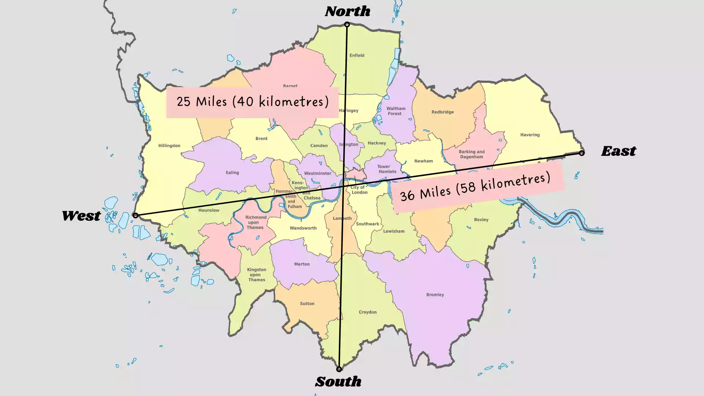

# Populate Pubs Note

> **Accepted decision**

## Problem

Google Maps has a high API cost. Furthermore, a simple search returning pubs in London only retrieves a limited number of pubs, mostly from the city center. It will be necessary to perform a series of searches and ensure these are fairly efficient due to the API cost. These searches will be conducted sporadically, so extreme efficiency is not vital.

## Decision

Used Places API Text Search. Since there is no dedicated "pub" type, it was found to be most effective to use the text search with the keyword "pub."

In the future, clever caching and prior information about the search grid can be used to optimize efficiency and reduce redundant API calls.

## Current decision



Use a rectangular grid as the first implementation. The current utility uses the approximate bounding box below and divides it into 8 latitude divisions and 12 longitude divisions:

```text
top-left:     (51.6723432, -0.563)
bottom-right: (51.3849401, 0.278)
```

The grid is deliberately simple and gives an initial baseline for measuring coverage, duplicates, request count, and runtime before introducing a more complex adaptive layout.

## Options Considered

- Ellipsis Search → Using a grid with location restriction ensures 100% coverage and is therefore a better approach. When starting this search, I did not initially realize that the location restriction rectangle was an available option.
