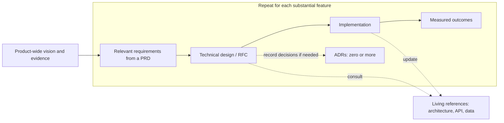

# Common product and engineering documents

B2C tech companies use different names and formats for these documents. The purpose of each document matters more than having a separate file for every category.

The number of documents and how they change over time depend on their purpose. A "source of truth" means the agreed place to find a particular answer; it does not have to be a single document for the whole product.

## Product vision and strategy

- **Usually contains:** The target users, their problem, the product's intended value, and the direction the team wants to take.
- **Does not contain:** Detailed feature requirements or a technical solution.
- **Typical pattern:** One current vision per product, updated when the direction changes.

## Business case

- **Usually contains:** The reasons the product might be viable, with costs, revenue opportunities, and assumptions to test.
- **Does not contain:** A promise that the assumptions are proven, or a feature specification.
- **Typical pattern:** One per product or major initiative, revised as evidence replaces assumptions.

## Product requirements document (PRD)

- **Usually contains:** User journeys, feature requirements, scope, success measures, and non-functional requirements such as accessibility, privacy, reliability, or performance.
- **Does not contain:** The detailed engineering solution for each feature.
- **Typical pattern:** Many over time, often one per feature or initiative, though one PRD can also cover a whole release. Each is the current source of truth for its agreed product scope while that scope is being developed.

## Technical design document or RFC

- **Usually contains:** How a requirement will be built, the main options and tradeoffs, changes to components, data or APIs, risks, and how the solution will be checked. An RFC is a proposal shared for comments before a decision.
- **Does not contain:** A replacement for the PRD's user needs and product scope.
- **Typical pattern:** Many over time, one for each substantial technical change. A proposal may be revised during review, then accepted, rejected, or superseded.

## Architecture decision record (ADR)

- **Usually contains:** One lasting technical decision, why it was made, and the alternatives considered.
- **Does not contain:** Every implementation step or a full account of the system.
- **Typical pattern:** Many small records, one per decision. Keep the historical decision intact; record a later reversal in a new ADR that supersedes it.

## Architecture and interface reference

- **Usually contains:** The system's current components, APIs, data model, and how they fit together.
- **Does not contain:** A proposal for a feature that has not been built yet.
- **Typical pattern:** Several living references, divided by subject or interface. Keep one canonical explanation for each subject up to date; code, schemas, and published contracts settle exact implemented behavior.

## Other documents as the product grows

Teams may also keep user research findings, UX flows, a roadmap, measurement or experiment plans, and launch or operations plans. Add these documents when there is real evidence or a concrete plan to record.

## Practical chain

The vision and evidence are product-wide; the boxed flow repeats for each substantial feature. The same PRD may supply requirements to several feature flows. There is usually one technical proposal for a substantial feature, while each ADR records one lasting decision, if any. A feature can produce several ADRs. The living references sit alongside feature work and are updated as the system changes. A task (GitHub issue for this repo) tracks a bounded piece of work; it does not replace these documents.
